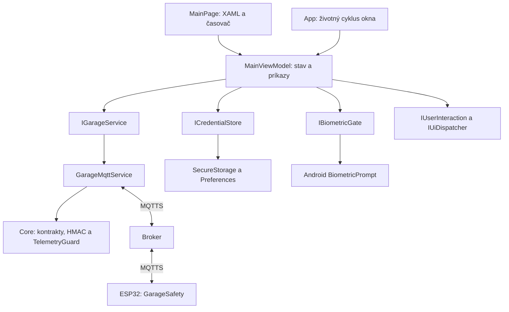

# Architektúra a plán rozširovania

## Aktuálny rozsah: Štádium 1, krok A1

Jedna garáž, ESP32, MQTT broker a MAUI aplikácia. V kroku A1 sa obrazovka
oddelila od riadenia relácie pomocou ViewModelu a testovateľných rozhraní.
Komunikačný protokol a firmware zostali kompatibilné s prvým commitom.

## Zodpovednosti

| Súčasť | Čo vlastní | Čo nevlastní |
|---|---|---|
| `MainPage` | XAML väzby, BindingContext, sekundový refresh pri zobrazení. | Heslá, login workflow, rozhodovanie o otvorení. |
| `MainViewModel` | Editované nastavenia, texty, command stav, prihlasovanie, potvrdenie a zrušenie relácie. | MQTTnet API, GPIO, platformové úložisko a Android API. |
| `IGarageService` | Rozhranie pre sledovanie garáže a odoslanie overeného otvorenia. | Konkrétny protokol obrazovky alebo konkrétnu platformu. |
| `GarageMqttService` | TLS spojenie, podpisy, ochranu telemetrie, jediný publish a párovanie potvrdenia. | Biometrický dialóg a vykresľovanie. |
| `CredentialStore` | Uloženie/načítanie credential bundle a pripojovacieho profilu. | Autorizáciu fyzického otvorenia. |
| `Core` | Kontrakty, validáciu správ, podpisovanie, replay a časové pravidlá. | MAUI, Android alebo MQTTnet klienta. |
| `GarageSafety` v ESP32 | Aktuálny reed vstup, replay/expiráciu, pulz a interlocky. | Stav mobilnej obrazovky alebo dostupnosť Raspberry Pi. |

Rozhrania sa pridali pri skutočných hraniciach služby/platformy, aby bolo možné
testovať pôvodný ViewModel bez telefónu. Modely a MQTT implementácia zostávajú
v existujúcich projektoch. Samostatný `Application` či `Infrastructure.Mqtt`
projekt sa oddelí pri konkrétnom druhom spotrebiteľovi; prázdne projekty sa
nevytvárajú vopred.

## Zachované bezpečnostné pravidlá

1. MQTT sa pripája iba cez TLS s overovaním certifikátu a hostname.
2. Telemetria aj príkazy majú HMAC podpis viazaný na tému a presný text správy.
3. Príkaz `open` má krátku platnosť a patrí aktuálnej relácii ESP32.
4. ViewModel vyžaduje prihlásenú reláciu, dostupnú silnú biometriu a čerstvý
   zatvorený stav pred aj po biometrickom potvrdení.
5. MQTT služba nezávisle preverí stav tesne pred odoslaním; ESP32 znovu overí
   príkaz a fyzický vstup pred zopnutím.
6. Nejasný výsledok príkazu nikdy nespúšťa automatické opakovanie.
7. `App` pri zastavení alebo zániku okna volá `MainViewModel.LockAsync()`;
   lokálne oprávnenie a token operácie sa zrušia pred čakaním na odpojenie.
8. Rozpracované odpojenie blokuje nové prihlásenie. Rôzne príkazy používajú
   spoločnú busy bránu, aby sa neprekrývali.
9. Čerstvosť pre zobrazenie aj otvorenie pochádza z rovnakej kontroly MQTT
   služby vrátane monotónneho času; ViewModel ju nepredlžuje vlastným odhadom.

`AsyncRelayCommand` z CommunityToolkit.Mvvm poskytuje väzby príkazov.
Bezpečnosť nesmie závisieť iba od `CanExecute`: metódy znovu overujú podmienky
aj pri priamom volaní. Všetky transportné udalosti aktualizujú stav obrazovky
cez `IUiDispatcher`.

Biometria zatiaľ predstavuje aplikačné potvrdenie. Kryptografické naviazanie
kľúča na každé biometrické použitie, Secure Boot a flash encryption patria do
ďalšieho bezpečnostného kroku. Tieto možnosti sa týmto refaktorom nepridali.

## Poradie ďalších krokov

| Krok | Stav | Konkrétny výsledok |
|---|---|---|
| A1 | Implementované | ViewModel, testovateľné služby, používateľský návod a testovací plán. |
| A2 | Plánované | Identita a katalóg zariadení, podporované funkcie, profily viacerých zariadení. |
| A3 | Plánované | Verzia protokolu a migračné pravidlá pri zachovaní existujúcich zariadení. |
| A4 | Plánované | Simulátor zariadenia pre reálnu MQTT cestu a poruchové scenáre bez GPIO. |
| B | Čaká na praktické skúšky | Pixel, broker, ESP32, senzory, oddelené relé a potom pohon. |
| C | Plánované | Súkromný broker a Tailscale na Raspberry Pi, ACL, TLS a obnova konfigurácie. |
| D | Plánované | Gateway pre jednoduché Arduino cez USB/RS485, história a evidencia udalostí. |
| E | Plánované | Kamera, úložisko, automatizácie a spoľahlivé upozornenia na pozadí. |

Každý krok má vlastný overiteľný commit. Pri zmenách protokolu sa navrhne
kompatibilita so starším firmvérom ešte pred prepnutím klienta. Nové zariadenie
nebude automaticky získavať oprávnenia na existujúce garáže.

Raspberry Pi bude poskytovať doplnkové služby a adaptéry. Bezpečnostná logika
relé zostane pri zariadení. Jednoduché Arduino pripojené cez gateway má inú
bezpečnostnú hranicu než ESP32 s priamym TLS pripojením; treba ju zohľadniť
v konkrétnom adaptéri. Pri ESP32 sa použije LAN alebo správne smerovanie do
súkromnej siete, nie predpoklad automatického Tailscale klienta na doske.

## Ako overovať architektonické zmeny

- Core testy musia ďalej odmietať expirované, zmenené a opakované správy.
- Testy MQTT používajú rovnaký implementačný zdroj ako aplikácia.
- ViewModel sa testuje bez MAUI cez jeho skutočný zdroj a riadené služby.
- Zostavy Android a Windows preverujú typy a kompilované XAML väzby.
- Spustením aplikácie sa osobitne overí zostavenie DI kontajnera a vykreslenie obrazovky.
- Manuálne testy osobitne preveria zobrazenie, biometriu, SecureStorage a GPIO.

Detaily a hranice dôkazov sú v [TESTING.md](TESTING.md).

Použitá knižnica: [ObservableObject](https://learn.microsoft.com/dotnet/communitytoolkit/mvvm/observableobject)
a [AsyncRelayCommand](https://learn.microsoft.com/dotnet/communitytoolkit/mvvm/asyncrelaycommand).
