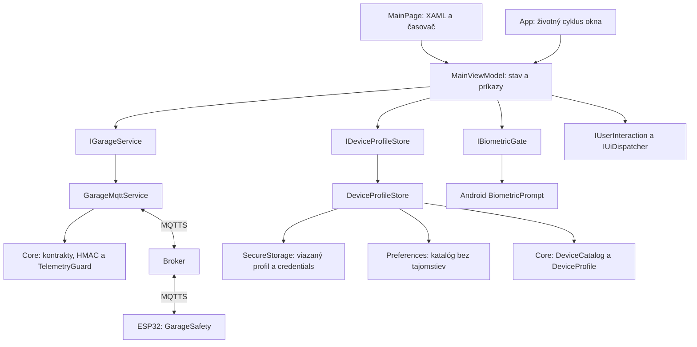

# Architektúra a plán rozširovania

## Aktuálny rozsah: Štádium 1, krok A2

Viac profilov garáží/meraní, vždy jedna aktívna MQTT relácia, ESP32 a MAUI
aplikácia. Po oddelení obrazovky v A1 pribudli v A2 identita, katalóg a
nastaviteľné funkcie. Komunikačný protokol a firmware zostávajú kompatibilné
s prvým commitom.

## Zodpovednosti

| Súčasť | Čo vlastní | Čo nevlastní |
|---|---|---|
| `MainPage` | XAML väzby, BindingContext, sekundový refresh pri zobrazení. | Heslá, login workflow, rozhodovanie o otvorení. |
| `MainViewModel` | Výber a editovanie profilu, texty, command stav, prihlasovanie, potvrdenie a zrušenie relácie. | MQTTnet API, GPIO, platformové úložisko a Android API. |
| `IGarageService` | Rozhranie pre sledovanie garáže a odoslanie overeného otvorenia. | Konkrétny protokol obrazovky alebo konkrétnu platformu. |
| `GarageMqttService` | TLS spojenie, funkcie pripojeného profilu, podpisy, históriu každej MQTT identity, jediný publish a párovanie potvrdenia. | Biometrický dialóg a vykresľovanie. |
| `DeviceProfileStore` | Katalóg bez hesiel, oddelené šifrované údaje podľa ID, kontrolu väzby profilu a migráciu pôvodných nastavení. | Autorizáciu fyzického otvorenia. |
| `Core` | Katalóg, identitu, konfiguráciu funkcií, kontrakty, validáciu správ, podpisovanie, replay a časové pravidlá. | MAUI, Android alebo MQTTnet klienta. |
| `GarageSafety` v ESP32 | Aktuálny reed vstup, replay/expiráciu, pulz a interlocky. | Stav mobilnej obrazovky alebo dostupnosť Raspberry Pi. |

Rozhrania sa pridali pri skutočných hraniciach služby/platformy, aby bolo možné
testovať pôvodný ViewModel bez telefónu. Modely a MQTT implementácia zostávajú
v existujúcich projektoch. Samostatný `Application` či `Infrastructure.Mqtt`
projekt sa oddelí pri konkrétnom druhom spotrebiteľovi; prázdne projekty sa
nevytvárajú vopred.

## Profily a budúce rozšírenia

`DeviceProfile` skladá stabilné lokálne `Id`, používateľský `Name`, samostatný
hodnotový objekt `MqttSettings Connection` a `DeviceCapabilities`. ID sa pri
zmene mena alebo endpointu nemení. Model nie je viazaný na názvy dosiek.
Raspberry Pi môže poskytnúť iný TLS endpoint; budúci Arduino adaptér musí
implementovať podporovaný protokol a zachovať lokálne bezpečnostné pravidlá.

`DeviceCatalog` vlastní verziu lokálneho formátu, zoznam profilov a vybrané ID.
Validácia odmieta duplicitné ID/názvy, rovnaký broker s rovnakou témou, neznáme
funkcie a viac než 32 zariadení. Zmena existujúceho profilu zachová jeho poradie.
Funkcia `OpenGarage` vyžaduje `DoorState`; profil iba na sledovanie nemôže
odoslať otvorenie ani priamym volaním `GarageMqttService.OpenAsync`.

Konfigurácia funkcií riadi zobrazenie a ďalej obmedzuje príkazy. Nenahrádza ACL,
biometriu ani nezávislú kontrolu firmvéru. V tejto etape nie je automatické
vyhľadávanie ani vyjednávanie funkcií so zariadením. Aj profil iba na teplotu
musí posielať dnešný podpísaný formát obsahujúci `door`; jeho zovšeobecnenie
patrí do A3. Kamery a NAS dostanú vlastné služby pri skutočnej implementácii.

ID je lokálna identita profilu, ešte nie identita v podpísanej MQTT správe.
TLS overuje endpoint, zatiaľ čo podpis viaže presnú tému a HMAC kľúč. Pred
rozšírením wire formátu sa v A3 určia verzia a pravidlá kompatibility.

Výber v zozname je návrh; používateľ ho potvrdí načítaním. Nezhoda výberu
s aktívnym profilom okamžite zablokuje ovládanie a skryje jeho telemetriu.
Načítanie profilu alebo vytvorenie nového najprv zruší lokálne oprávnenie,
odpojí transport, vyprázdni tajné polia a až potom zmení editor. Nový profil
sa uloží pri zadaní vlastných prihlasovacích údajov. Automatické pripojenie
ani automatické zopakovanie príkazu sa nepridáva.

## Úložisko a prechod zo staršej verzie

- `Preferences` obsahuje jediný katalóg `mqtt.devices.v1` bez hesiel a kľúčov.
- `SecureStorage` obsahuje pre každé GUID samostatný bundle
  `mqtt.device.<GUID bez pomlčiek>.v2`. Spolu s credentials ukladá presnú
  kópiu profilu; pri načítaní musia obe kópie zodpovedať.
- Zmena endpointu, témy alebo funkcií iba v Preferences preto nesprístupní
  staré credentials. Úprava cez aplikáciu vyžaduje ich opätovné zadanie.
- Zápis secure bundle predchádza publikovaniu verejných metadát. Úložiská
  netvoria databázovú transakciu: pri čiastočnom zlyhaní sa nezhodný profil
  nedá odomknúť. Opätovné uloženie správnych údajov obnoví konzistenciu.
- Pôvodné `mqtt.settings.v1` sa zobrazí ako „Garáž 1“ so stabilným ID bez
  čítania tajomstiev. Pri prvom úspešne autorizovanom načítaní sa skopírujú
  pôvodné credentials; až po zápise nového formátu sa odstránia staré kľúče.
  Prerušená migrácia sa dokončí pri ďalšom načítaní. Starý formát neobsahuje
  väzbu na secure metadata; pred prvou migráciou overte pôvodný endpoint.
- Poškodený alebo novší katalóg sa potichu neprepíše prázdnym. Odstránenie
  profilu sa týka iba jeho ID; ostatné profily a ich credentials zostávajú.

Platformové správanie a možné chyby úložiska opisuje
[SecureStorage dokumentácia](https://learn.microsoft.com/en-us/dotnet/maui/platform-integration/storage/secure-storage?view=net-maui-10.0).

## Zachované bezpečnostné pravidlá

1. MQTT sa pripája iba cez TLS s overovaním certifikátu a hostname.
2. Telemetria aj príkazy majú HMAC podpis viazaný na tému a presný text správy.
3. Príkaz `open` má krátku platnosť a patrí aktuálnej relácii ESP32.
4. ViewModel vyžaduje prihlásenú reláciu, dostupnú silnú biometriu a čerstvý
   zatvorený stav pred aj po biometrickom potvrdení.
5. MQTT služba nezávisle preverí stav tesne pred odoslaním; ESP32 znovu overí
   príkaz a fyzický vstup pred zopnutím.
6. Nejasný výsledok príkazu nikdy nespúšťa automatické opakovanie.
7. `App` pri zastavení alebo zániku okna volá `MainViewModel.LockAsync()`;
   lokálne oprávnenie a token operácie sa zrušia pred čakaním na odpojenie.
8. Rozpracované odpojenie blokuje nové prihlásenie. Rôzne príkazy používajú
   spoločnú busy bránu, aby sa neprekrývali.
9. Čerstvosť pre zobrazenie aj otvorenie pochádza z rovnakej kontroly MQTT
   služby vrátane monotónneho času; ViewModel ju nepredlžuje vlastným odhadom.
10. Prepnutie A → B → A zachová replay históriu pre obe identity. Cache má
    najviac 64 identít téma/odtlačok HMAC kľúča počas behu procesu.
    Limit spôsobí odmietnutie novej identity, nie vymazanie starej histórie.
    Zmena brokera/portu/režimu nemení identitu podpísaného toku. Ani návrat
    k predchádzajúcemu HMAC kľúču nevymaže jeho už prijaté správy.
    Osobitný limit 64 vyradených `boot` relácií platí v každom `TelemetryGuard`.
11. ViewModel povoľuje otvorenie iba pre nezmenený prihlásený profil; služba
    znovu kontroluje jeho uloženú funkciu `OpenGarage` pod vlastným zámkom.

`AsyncRelayCommand` z CommunityToolkit.Mvvm poskytuje väzby príkazov.
Bezpečnosť nesmie závisieť iba od `CanExecute`: metódy znovu overujú podmienky
aj pri priamom volaní. Všetky transportné udalosti aktualizujú stav obrazovky
cez `IUiDispatcher`.

Biometria zatiaľ predstavuje aplikačné potvrdenie. Kryptografické naviazanie
kľúča na každé biometrické použitie, Secure Boot a flash encryption patria do
ďalšieho bezpečnostného kroku. Tieto možnosti sa týmto refaktorom nepridali.

## Poradie ďalších krokov

| Krok | Stav | Konkrétny výsledok |
|---|---|---|
| A1 | Implementované | ViewModel, testovateľné služby, používateľský návod a testovací plán. |
| A2 | Implementované | Stabilné ID, validovaný katalóg, nastaviteľné funkcie, oddelené credentials, migrácia a prepínanie profilov. |
| A3 | Plánované | Verzia protokolu a migračné pravidlá pri zachovaní existujúcich zariadení. |
| A4 | Plánované | Simulátor zariadenia pre reálnu MQTT cestu a poruchové scenáre bez GPIO. |
| B | Čaká na praktické skúšky | Pixel, broker, ESP32, senzory, oddelené relé a potom pohon. |
| C | Plánované | Súkromný broker a Tailscale na Raspberry Pi, ACL, TLS a obnova konfigurácie. |
| D | Plánované | Gateway pre jednoduché Arduino cez USB/RS485, história a evidencia udalostí. |
| E | Plánované | Kamera, úložisko, automatizácie a spoľahlivé upozornenia na pozadí. |

Každý krok má vlastný overiteľný commit. Pri zmenách protokolu sa navrhne
kompatibilita so starším firmvérom ešte pred prepnutím klienta. Nové zariadenie
nebude automaticky získavať oprávnenia na existujúce garáže.

Raspberry Pi bude poskytovať doplnkové služby a adaptéry. Bezpečnostná logika
relé zostane pri zariadení. Jednoduché Arduino pripojené cez gateway má inú
bezpečnostnú hranicu než ESP32 s priamym TLS pripojením; treba ju zohľadniť
v konkrétnom adaptéri. Pri ESP32 sa použije LAN alebo správne smerovanie do
súkromnej siete, nie predpoklad automatického Tailscale klienta na doske.

## Ako overovať architektonické zmeny

- Core testy musia ďalej odmietať expirované, zmenené a opakované správy.
- Testy MQTT používajú rovnaký implementačný zdroj ako aplikácia.
- ViewModel sa testuje bez MAUI cez jeho skutočný zdroj a riadené služby.
- Zostavy Android a Windows preverujú typy a kompilované XAML väzby.
- Spustením aplikácie sa osobitne overí zostavenie DI kontajnera a vykreslenie obrazovky.
- Manuálne testy osobitne preveria zobrazenie, biometriu, SecureStorage a GPIO.

Detaily a hranice dôkazov sú v [TESTING.md](TESTING.md).

Použitá knižnica: [ObservableObject](https://learn.microsoft.com/dotnet/communitytoolkit/mvvm/observableobject)
a [AsyncRelayCommand](https://learn.microsoft.com/dotnet/communitytoolkit/mvvm/asyncrelaycommand).
